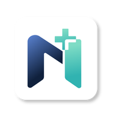

<div align="center">



# NOVA

**Inovasi Platform Pembelajaran Adaptif dan Monitoring Perkembangan Siswa *Slow Learner* Berbasis AI**
<br>guna meningkatkan efektivitas pembelajaran berdiferensiasi di sekolah inklusif


*Satu misi dari sekolah, dinilai dari banyak sudut pandang, dilaporkan tanpa peringkat.*

</div>

---

## Tentang repo ini

Repo ini berisi **web showcase NOVA**: satu halaman yang mengumpulkan karya Tim Restu Bumi untuk juri dan publik, mulai dari prototipe, video profil, makalah, slide, sampai poster. QR code di poster final mengarah ke halaman ini.

## Tentang NOVA

NOVA adalah platform pembelajaran berbasis mobile untuk **siswa *slow learner*** dan **guru mata pelajaran** di SMA/SMK inklusif. Guru Pembimbing Khusus (GPK) dan orang tua ikut terhubung dalam satu siklus belajar.

<table>
<tr>
<td width="33%" valign="top">

### 🌉 Adaptive Cognitive Bridge
Materi bergerak bertahap dari **konkret → visual → abstrak** (UDL + CRA). Siswa menjawab lewat suara, foto, urutkan kartu, atau pilihan ganda.

</td>
<td width="33%" valign="top">

### 🧑‍🏫 Teacher-in-the-Loop
AI menyusun draf misi dari modul dan konteks lokal. **Guru yang mengedit, menilai, dan menerbitkan.** AI tidak pernah menilai sendiri.

</td>
<td width="33%" valign="top">

### 🔁 Closed-Loop Learning
Penilaian guru menentukan tindak lanjut: lanjut atau **Misi Penguatan**. Orang tua menerima **rapor deskriptif** tanpa peringkat.

</td>
</tr>
</table>

### 🍎 Satu misi, banyak lensa
Topik sehari-hari seperti *"Sisa Apel di Kantin"* dibahas lintas mapel. Matematika bertanya berapa apel yang tersisa, Biologi bertanya kenapa apel busuk, Fisika bertanya kenapa apel jatuh, dan setiap guru menilai dari lensanya sendiri.

## Hasil uji purwarupa

Diuji di **SMAN 4 Sidoarjo** bersama guru mata pelajaran, GPK, siswa *slow learner*, dan orang tua.

| Metrik | Hasil | Responden |
|---|:---:|---|
| System Usability Scale (SUS) | **85,42** · sangat baik | Guru & GPK |
| UEQ-S keseluruhan | **1,79** | Guru & GPK |
| Kesenangan belajar (Smileyometer) | **4,8** | Siswa |
| Success rate | **100%** | Siswa & guru |
| Hipotesis H1–H5 | **Diterima** | — |

## Isi halaman

| Bagian | Isi |
|---|---|
| Hero | Identitas NOVA dan tiga layar utama |
| Fitur kunci | Buat Misi Bersama · Jawab Multimodal · Nilai Berbasis Bukti · Level Tanaman · Rapor Deskriptif |
| 1 · Latar belakang | Defisit GPK 87% dan *cognitive overload* |
| 2 · Satu misi banyak lensa | Konsep misi tematik lintas mapel |
| 3 · Tiga inovasi inti | Cognitive Bridge, Teacher-in-the-Loop, Closed-Loop |
| 4 · Ekosistem | Layar per peran: siswa, guru mapel, GPK, orang tua |
| 5 · Semifinal ke final | Perbandingan layar sebelum dan sesudah |
| 6 · Perjalanan iterasi | Iterasi 0 sampai purwarupa final |
| 7 · Hasil uji | Metrik dan dokumentasi uji lapangan |
| 8 · Karya tim | Video profil, makalah, slide, poster |
| Tim | Tim Restu Bumi dan dosen pembimbing |

## Menjalankan dan mengubah

Situs ini statis, tanpa build step dan tanpa dependensi.

```bash
git clone https://github.com/Naufal-Ghani22/NOVA-Showcase.git
cd NOVA-Showcase
# buka index.html langsung di browser, atau jalankan server lokal:
python -m http.server 8000
```

Semua tautan dikumpulkan di satu tempat, yaitu blok `LINKS` di bagian bawah `index.html`:

```js
const LINKS = {
  prototipe:"", siswa:"", guru:"", gpk:"", ortu:"",  // link Figma prototype
  video:"",                                          // link YouTube, otomatis jadi pemutar
  makalah:"", slide:"", poster:"",
  naufal:"", kaka:"", daniel:""                      // akun tim
};
```

Tautan yang masih kosong tetap aman. Tombol dokumen tampil dengan label *segera tersedia*.

## Struktur

```
NOVA-Showcase/
├── index.html        # seluruh halaman (HTML + CSS + JS)
└── aset/
    ├── ui/           # layar purwarupa NOVA
    ├── foto/         # dokumentasi uji lapangan
    ├── apel.webp     # ilustrasi "satu misi banyak lensa"
    ├── tim.webp      # foto tim
    ├── m-*.png       # maskot NOVA
    └── logo.png
```

**Teknologi:** HTML, CSS, dan JavaScript murni · Montserrat dan Plus Jakarta Sans (Google Fonts) · responsif untuk ponsel · mendukung *reduced motion*.

## Tim Restu Bumi

| Nama | Peran |
|---|---|
| Naufal Ghani Bekti | Product & UX Lead |
| Kaka Dimas Soehendra Putra | Research & Validation |
| Daniel | Communication & Delivery |

**Dosen pembimbing:** Reisa Permatasari, ST, M.Kom
**Universitas Pembangunan Nasional "Veteran" Jawa Timur** · Lokasi riset: SMAN 4 Sidoarjo

---

<div align="center">
<sub>Dibuat untuk Babak Final GEMASTIK XIX 2026 · Divisi Desain Pengalaman Pengguna</sub>
</div>
